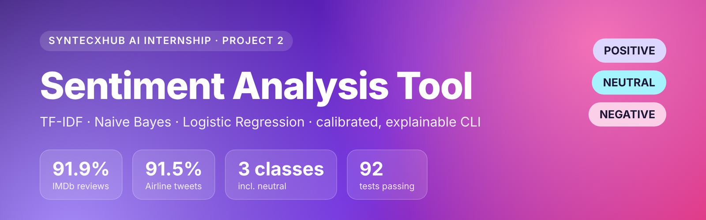
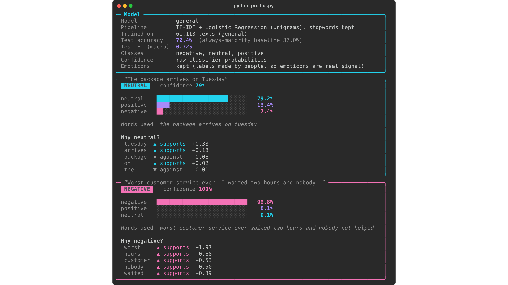
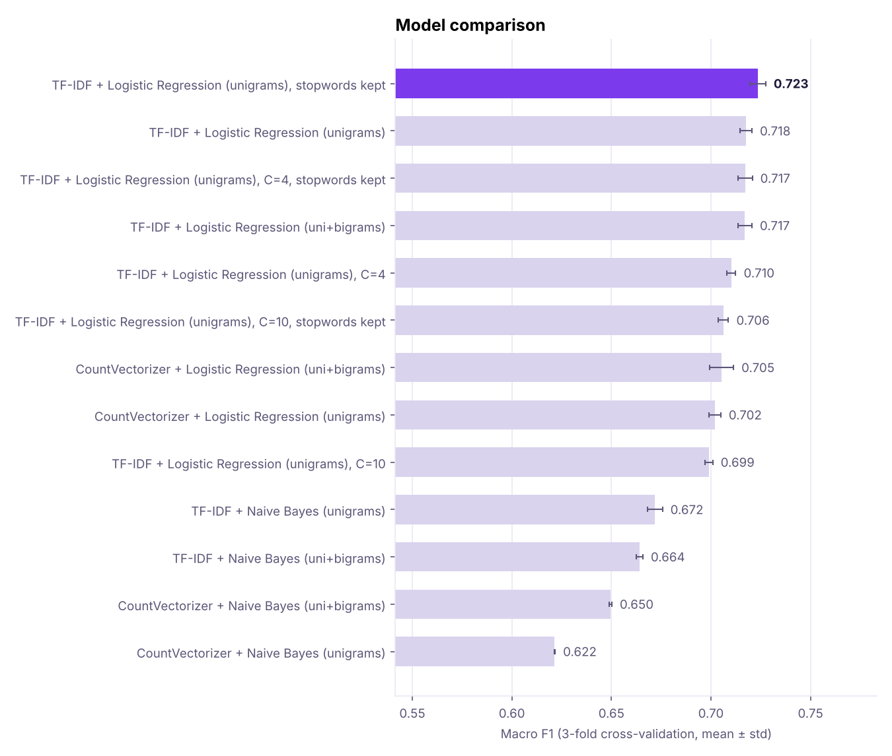
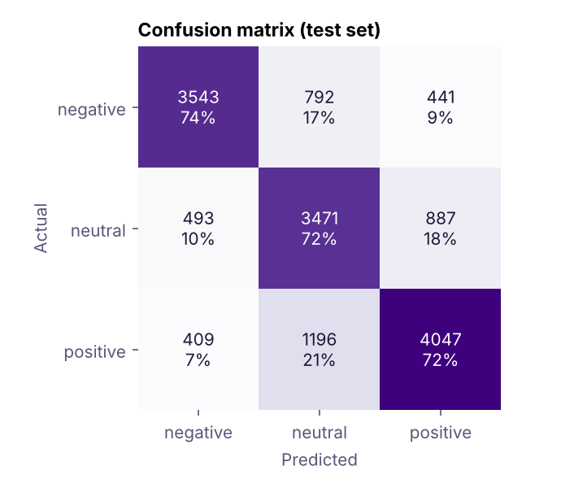
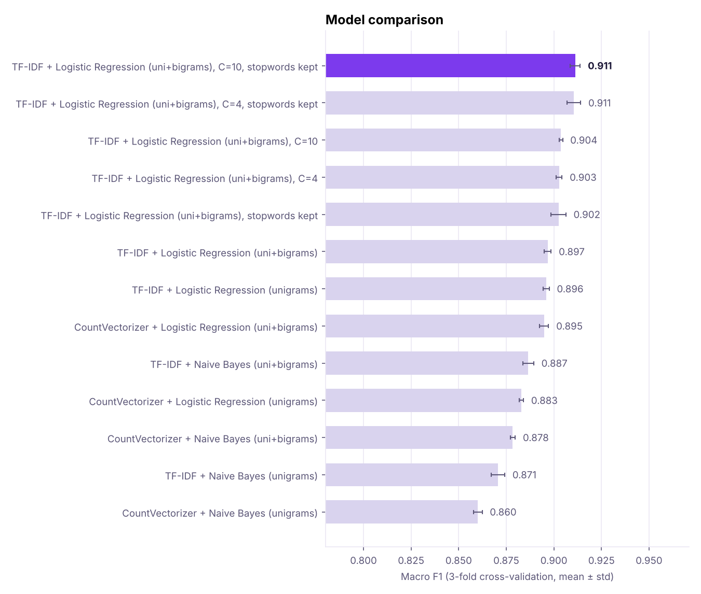
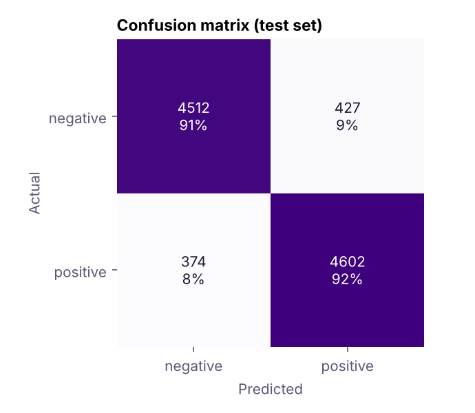
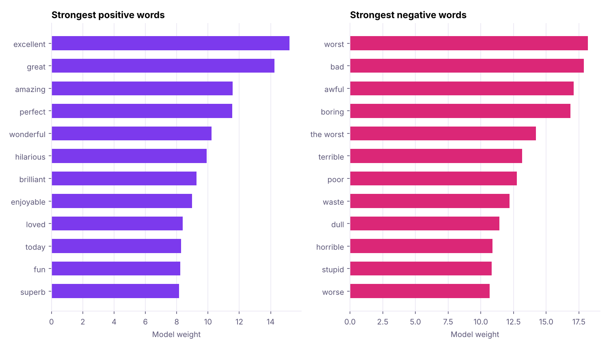
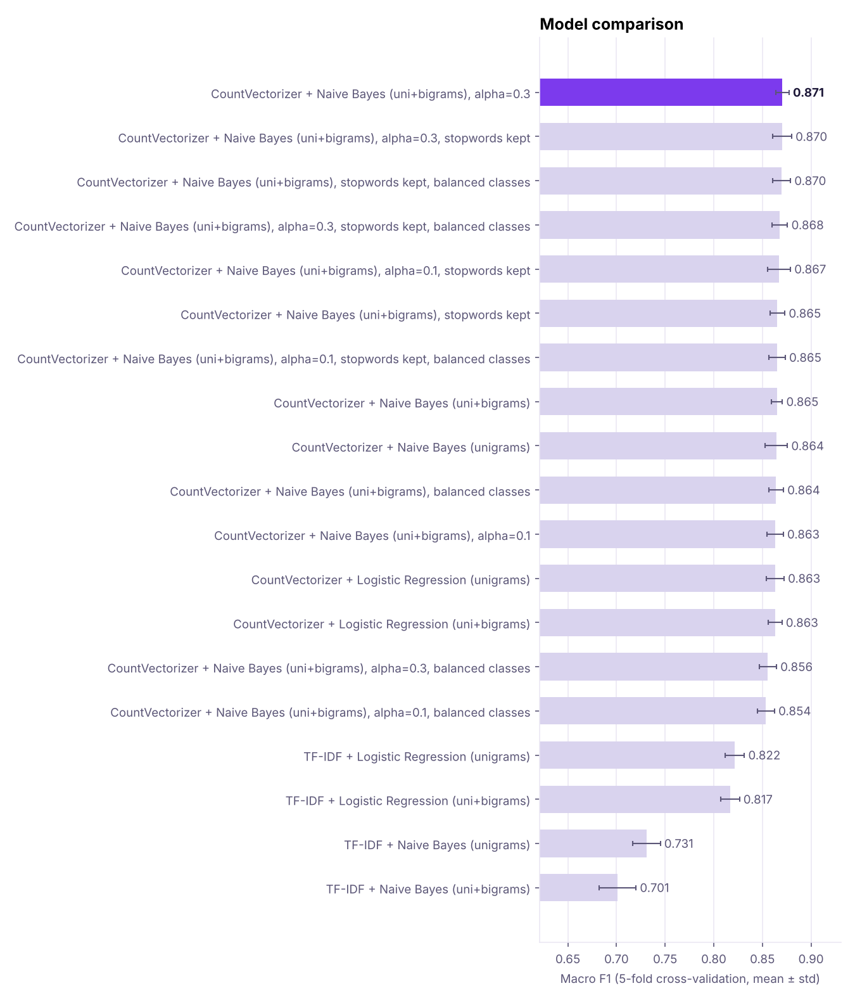
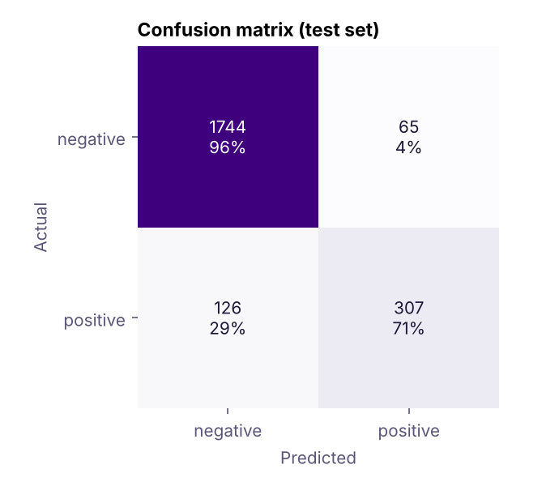
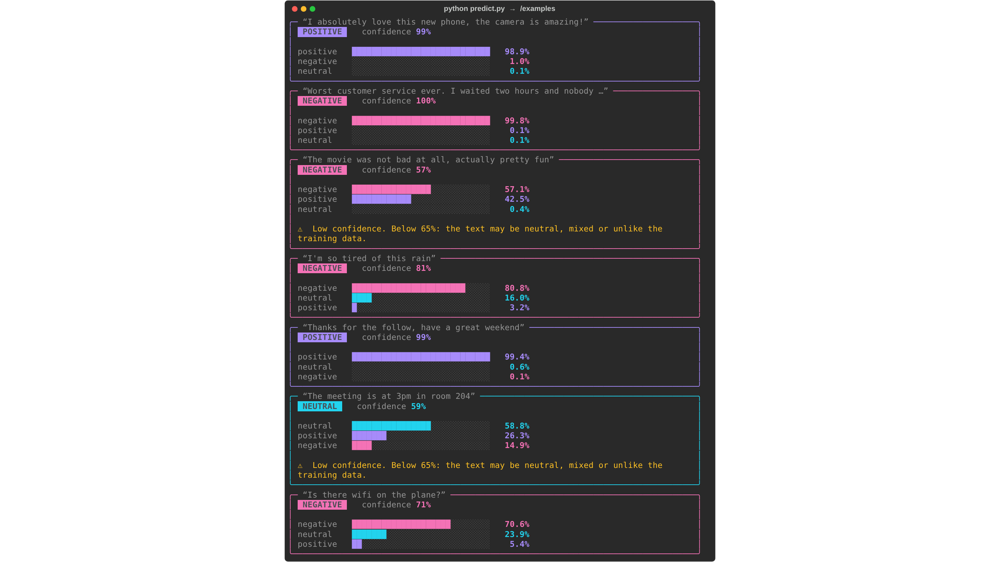

<div align="center">



<br><br>


**Syntecxhub AI Internship · Week 2 · Project 2**

[Quick start](#-quick-start) · [Results](#-results) · [Improvements](#-improvements-over-the-first-version) · [How it works](#-how-it-works) · [Limitations](#-limitations)

</div>

---

A classic NLP pipeline (text cleaning → CountVectorizer / TF-IDF → Naive Bayes / Logistic Regression) that learns sentiment from labelled tweets and reviews. It compares eight model variants with cross-validation, tunes the best one, checks whether its confidence scores need calibrating, and reports accuracy and F1 on a held-out test set. A command-line tool predicts new text and shows **which words** drove each prediction.

<table>
<tr>
<td align="center" width="33%"><h3>🎬 IMDb</h3><b>91.9%</b> accuracy<br>macro-F1 0.919<br><sub>50,000 movie reviews · positive / negative</sub></td>
<td align="center" width="33%"><h3>✈️ Airline</h3><b>91.5%</b> accuracy<br>macro-F1 0.855<br><sub>11,000 tweets labelled by people · positive / negative</sub></td>
<td align="center" width="33%"><h3>🌍 General</h3><b>72.4%</b> accuracy<br>macro-F1 0.725<br><sub>76,000 tweets + reviews · positive / negative / <b>neutral</b></sub></td>
</tr>
</table>



## ✅ What the brief asked for, and where it is

| Requirement | Implementation |
|---|---|
| Load labelled text data (tweets / reviews) | Five datasets included in `data/` (IMDb reviews, airline tweets, TweetEval tweets, NLTK tweets and movie reviews), loaded by `sentiment/data.py`; or any CSV with `--csv` |
| Preprocess text (clean, tokenise) | `sentiment/preprocess.py`: `TextCleaner` removes HTML, URLs and mentions, handles emoticons, folds accents, expands *n't*, removes stopwords (keeps negations) and marks negation scope |
| Convert text to numeric features | **CountVectorizer** and **TF-IDF**, unigrams and uni+bigrams |
| Train a classifier and evaluate | **Multinomial Naive Bayes** and **Logistic Regression**, compared and tuned with cross-validation; accuracy, precision, recall, macro-F1, confusion matrix and calibration error on the test set |
| Small CLI to predict sentiment | `predict.py`: interactive mode, `--text`, `--file` to CSV, `--json` |

> [!TIP]
> **Prefer a notebook?** [`Sentiment_Analysis.ipynb`](Sentiment_Analysis.ipynb) walks through every step (exploration, cleaning, features, training, evaluation, experiments, the 3-class model and calibration) with all outputs included. It uses the same `sentiment/` code as the scripts.

## 🚀 Quick start

```bash
pip install -r requirements.txt

python train.py --dataset general    # 3 classes, any topic (the CLI default), about 11 min
python train.py --dataset imdb       # most accurate on reviews, 91.9 %, about 24 min
python train.py --dataset airline    # airline tweets, 91.5 %, under 1 min

python predict.py                    # interactive CLI (general model)
python predict.py --text "I love this!" --text "The package arrives on Tuesday"
python predict.py --model imdb --text "Two hours of my life I will never get back."
python predict.py --model airline --file inputs.txt --out predictions.csv
```

Training times are measured on a 2-core machine; a modern laptop is faster. `--no-tune` skips stage 2 and is about 40 % quicker.

**Which model should I use?**

| Your text | Model |
|---|---|
| Anything, and some of it may be neutral (questions, facts, announcements) | `general` (default) |
| Movie or product reviews that are clearly positive or negative | `imdb` |
| Customer-service tweets that are clearly positive or negative | `airline` |

## 📊 Results

All numbers come from `results/*/metrics.json`, written by `train.py` (seed 42, 80/20 stratified split). Model selection uses cross-validation on the training set only; the test set is used once at the end.

| Dataset | Classes | Train / test | Best model (chosen by CV) | Accuracy | Majority baseline | Macro-F1 |
|---|---|---|---|---|---|---|
| **IMDb reviews** | 2 | 39,660 / 9,915 | TF-IDF + Logistic Regression (uni+bigrams), C=10, stopwords kept | **91.9%** | 50.2% | **0.919** |
| **Airline tweets** | 2 | 8,968 / 2,242 | CountVectorizer + Naive Bayes (uni+bigrams), alpha=0.3 | **91.5%** | 80.7% | **0.855** |
| **General** (tweets + reviews) | 3 | 61,113 / 15,279 | TF-IDF + Logistic Regression (unigrams), stopwords kept | **72.4%** | 37.0% | **0.725** |
| Movie reviews (NLTK) | 2 | 1,597 / 400 | TF-IDF + Logistic Regression (unigrams), C=10 | 88.0% | 50.0% | 0.880 |
| Airline tweets with neutral | 3 | 11,220 / 2,805 | CountVectorizer + Logistic Regression (uni+bigrams), stopwords kept | 80.4% | 64.4% | 0.726 |
| NLTK tweets (labelled by emoticons) | 2 | 7,014 / 1,754 | TF-IDF + Logistic Regression (uni+bigrams), stopwords kept | 75.3% | 51.6% | 0.752 |
| NLTK tweets, emoticons kept ⚠ | 2 | 7,178 / 1,795 | TF-IDF + Logistic Regression (uni+bigrams), C=4 | 99.3% | 51.4% | 0.993 |

- **Majority baseline** is the accuracy of always predicting the most common class. On the airline tweets that is already 80.7 % (81 % are complaints), which is why **macro-F1** is reported too: it weighs every class equally.
- **Three classes is a harder task.** Two-class models never have to decide whether "thanks, see you at 6" is positive or neutral; the general model does, and even the people who labelled TweetEval disagree on such cases.
- The ⚠ row is the **label-leakage** experiment (see *Data-quality findings*). It is not a real result.

### 🌍 General model: neutral text and many topics

Binary models must call every sentence positive or negative, and each one only knows its own domain. The airline model, trained on 81 % complaints, called "The package arrives on Tuesday" negative with 96 % confidence. The **general** dataset fixes both problems by mixing three sources, all labelled by people or star ratings:

| Source | Texts | Labels |
|---|---|---|
| [TweetEval](https://github.com/cardiffnlp/tweeteval) sentiment (SemEval-2017), train + validation | 47,615 everyday tweets on many topics | positive / negative / neutral |
| Airline tweets, neutral kept | 14,640 | positive / negative / neutral |
| IMDb, random sample | 15,000 reviews | positive / negative |

The split is stratified by source *and* label, and results are reported per source:

| Test data | Texts | Accuracy | Macro-F1 |
|---|---|---|---|
| All (test split) | 15,279 | **72.4%** | **0.725** |
| IMDb reviews | 3,000 | 86.5% | 0.865 |
| Airline tweets | 2,805 | 79.6% | 0.720 |
| TweetEval tweets | 9,474 | 65.8% | 0.620 |
| **TweetEval official test set** (never used for training or selection) | 12,284 | 60.8% | 0.594 |

On the official TweetEval test set the model scores 0.586 macro-recall, the benchmark's own metric. For comparison, the [TweetEval leaderboard](https://github.com/cardiffnlp/tweeteval) lists fine-tuned transformers (BERTweet, TimeLMs) at about 0.73 on that metric. That gap is the price of a fast bag-of-words model.

The same sentences across models (confidence in brackets):

| Text | Airline (binary) | IMDb (binary) | General (3 classes) |
|---|---|---|---|
| The package arrives on Tuesday | negative 96% | positive 61% | **neutral 79%** |
| The meeting is at 3pm in room 204 | negative 96% | positive 52% | **neutral 59%** |
| What time does the gate open? | negative 97% | positive 79% | **neutral 52%** |
| Is there wifi on the plane? | negative 94% | negative 70% | negative 71% ✗ |
| The battery died after two days, waste of money | negative 97% | negative 100% | negative 92% |
| Works perfectly, very happy with it | positive 61% | positive 100% | positive 100% |
| lost my bag again, thanks a lot @AmericanAir | negative 96% | positive 95% ✗ | negative 79% |
| not bad at all, actually pretty fun | negative 81% ✗ | negative 67% ✗ | negative 51% ✗ |
| great, another Monday | positive 59% ✗ | positive 94% ✗ | positive 99% ✗ |

The general model is the only one that answers *neutral*, and it handles product reviews it never saw. It is still a bag-of-words model: "wifi" mostly appears in airline complaints, and sarcasm and "not bad" are misread (see *Limitations*). Its low-confidence warning (below 65 %) fires on the meeting and gate sentences.

| Model comparison | Confusion matrix |
|---|---|
|  |  |

### 🎬 IMDb: the most accurate model

49,575 reviews after removing 418 exact and 7 near-duplicates. With 39,660 training reviews, cross-validation uses 3 folds instead of 5 to save time.

| Stage | Model | CV macro-F1 | Test accuracy | Test F1 |
|---|---|---|---|---|
| 2 | **TF-IDF + Logistic Regression (uni+bigrams), C=10, stopwords kept** | **0.911 ± 0.003** | 0.919 | 0.919 |
| 2 | TF-IDF + Logistic Regression (uni+bigrams), C=4, stopwords kept | 0.910 ± 0.004 | 0.917 | 0.917 |
| 2 | TF-IDF + Logistic Regression (uni+bigrams), C=10 | 0.904 ± 0.001 | 0.914 | 0.914 |
| 1 | TF-IDF + Logistic Regression (uni+bigrams) (stage-1 winner) | 0.897 ± 0.002 | 0.904 | 0.904 |

Tuning added 1.5 points over the untuned stage-1 winner (90.4 % → **91.9 %**): a higher `C` (less regularisation) and keeping stopwords such as "too", "very" and "well", which carry sentiment in reviews ("too long", "well done"). The errors are balanced: 427 negative reviews predicted positive and 374 positive reviews predicted negative.

| Model comparison | Confusion matrix |
|---|---|
|  |  |



### ✈️ Airline tweets: short texts labelled by people

11,210 positive or negative tweets after cleaning (81 % negative). Emoticons are **kept** here, because people read and labelled each tweet, so a 🙏 or `:)` is real evidence. Count + Naive Bayes wins: **91.5 %** accuracy, macro-F1 **0.855**, with 96 % of negative and 71 % of positive tweets correct. Positive tweets are harder because there are far fewer of them to learn from.

| Model comparison | Confusion matrix |
|---|---|
|  |  |

### 📁 Other datasets

- **NLTK movie reviews** (2,000): the same kind of text as IMDb with 25 times less data, 88.0 %.
- **NLTK tweets** (10,000): labelled automatically by the emoticon they contained, not by people. With the emoticons removed (as they must be, see below), many tweets carry little signal and no setting tried passed about 76 %. They are kept for the label-leakage experiment; for tweets, use the general or airline model.

## ✨ Improvements over the first version

| Problem | What was done | Result |
|---|---|---|
| No neutral class: a fact like "The package arrives on Tuesday" was called negative 96 % | Added the 3-class **general** model, trained on 47,615 TweetEval tweets plus airline tweets and IMDb reviews | Answers *neutral* for factual sentences; tested on 12,284 unseen TweetEval tweets |
| Each model only knew one domain (films, airlines) | The general model mixes everyday tweets, customer-service tweets and reviews | Handles product reviews and general topics it was not trained on |
| Tweet model limited by noisy emoticon labels | Human-labelled tweets (airline, TweetEval) replace the NLTK tweets as the recommended tweet models | 91.5 % on airline tweets; NLTK tweets kept only as a leakage demonstration |
| Over-confident probabilities (Naive Bayes said 99 % when it was right far less often) | **Probability calibration** (sigmoid, cross-validated), kept only when it lowers the cross-validated log loss | Calibration error on the airline model 0.042 → 0.015; IMDb 0.028 → 0.008; movie reviews 0.142 → 0.031 |
| Negation crossed removed emoticons: in "I don't like this :( so disappointed", "disappointed" became `not_disappointed` | A removed or kept emoticon now ends the negation scope, like punctuation | Fixed and covered by a regression test |

**Calibration** in more detail: a model's confidence should mean something, so of all predictions made with 90 % confidence, about 90 % should be right. The *calibration error* (ECE) is the average gap between confidence and actual accuracy. Calibration does not always help: the general model's Logistic Regression was already well calibrated (0.023), and calibrating it made the cross-validated log loss worse, so `train.py` kept its raw probabilities. The decision for each model is stored in its `metrics.json`.

| Model | Calibration error, raw → final | Calibrated? |
|---|---|---|
| IMDb | 0.028 → 0.008 | yes |
| Airline | 0.042 → 0.015 | yes |
| Movie reviews | 0.142 → 0.031 | yes |
| General | 0.023 | no (already calibrated) |

## 🔧 How it works

```
raw text ──► TextCleaner ──► CountVectorizer / TF-IDF ──► Naive Bayes / Logistic Regression ──► label + probability
              │                                            (+ sigmoid calibration if it helps)
              ├─ remove HTML tags, URLs, @mentions; "#happy" → "happy"
              ├─ emoticons: removed (NLTK tweets, where they are the label) or kept as tokens (human labels)
              ├─ lowercase, fold accents (İ → i, é → e), "don't" → "do not", "soooo" → "soo"
              ├─ tokenise, drop stopwords but keep negations (not, no, never…)
              └─ negation marking: "not happy" → "not not_happy" until punctuation, an emoticon or "but"
```

All steps live in one scikit-learn `Pipeline`, saved with `joblib`, so the CLI cleans text exactly the way the model was trained.

**Model selection.** The data is split 80/20 (stratified, seed 42; by source and label for the general dataset). Cross-validation runs **on the training set only** (5 folds, or 3 above 20,000 training texts):
1. **Stage 1:** the 8 combinations of vectorizer × classifier × n-grams.
2. **Stage 2:** the winner is tuned: `C` ∈ {1, 4, 10} for Logistic Regression or `alpha` ∈ {1, 0.3, 0.1} for Naive Bayes, with stopwords removed or kept. If the largest class is over 60 % of the data, each variant is also tried with balanced class weights.
3. **Calibration check:** cross-validated log loss with and without sigmoid calibration; the better one is kept.

The test set is used once for the final numbers. Test scores for every variant are listed in `metrics.json` for transparency, but play no part in the choice.

**Explanations.** For each prediction the CLI lists the words that pushed it towards or away from the predicted class: `weight × feature value`, where the weight is the Logistic Regression coefficient, or for Naive Bayes the log-probability of the word in that class minus its average in the other classes.

## 🔍 Data-quality findings

| Problem | Effect | Fix |
|---|---|---|
| **Label leakage.** NLTK labelled its tweets *by their emoticons* (`:)` = positive). | Keeping emoticons gives **99.3%**: the model reads the label back. | Emoticons are removed for that dataset; `--keep-emoticons` reproduces the leak. |
| **Near-duplicate spam,** e.g. "followed thanks followed" 51 times. | Copies in both train and test inflated accuracy by about 2 points. | `prepare()` drops texts that are identical or empty after cleaning. |
| **Conflicting labels:** the same cleaned text with different labels. | Unlearnable noise. | All copies dropped. |
| **Turkish dotted İ:** lowercasing "BELİEVE" adds an invisible combining dot. | Fake word fragments ("beli", "eve") among the top features. | Accent folding (Unicode NFKD) before tokenising. |
| **HTML in IMDb reviews** (`<br />` in 29,200 of 50,000). | "br" became a feature. | HTML tags are removed. |

## 🗂️ Project structure

```
Syntecxhub_Sentiment_Analysis_Tool/
├── Sentiment_Analysis.ipynb  # step-by-step notebook with outputs
├── train.py                 # compare 8 models, tune, calibrate, evaluate, save model + metrics + charts
├── predict.py               # CLI: interactive, --text, --file → CSV, --json
├── sentiment/
│   ├── preprocess.py        # TextCleaner: cleaning, tokenisation, negation marking
│   ├── data.py              # dataset loaders, general mix, prepare() de-duplication
│   ├── model.py             # pipelines, cross-validation, calibration, evaluation, explanations
│   └── plots.py             # model comparison, confusion matrix, top words charts
├── data/                    # the five datasets + README with sources
├── results/<model>/         # metrics.json + charts from the last training run
├── models/                  # trained .joblib files (created by train.py, not committed)
├── tests/                   # pytest suite
└── docs/                    # README screenshots
```

## 📥 Using your own data

Any CSV with a text column and a label column works, with two or more classes:

```bash
python train.py --csv my_reviews.csv --text-col review --label-col sentiment --name my_reviews
python predict.py --model my_reviews
```

## 💻 CLI reference

| Command | What it does |
|---|---|
| `python predict.py` | Interactive mode (general model if trained, then IMDb, airline…) |
| `--model imdb` | Use another trained model (name in `models/` or a `.joblib` path) |
| `--text "…"` | Predict one or more texts (repeat the flag) |
| `--file in.txt --out out.csv` | Batch: one text per line, writes sentiment, confidence and class probabilities |
| `--json` | Machine-readable output |

Inside interactive mode: `/examples`, `/model NAME`, `/models`, `/info`, `/details` (toggle explanations), `/history`, `/quit`. Predictions below 65 % confidence are flagged as uncertain.



## 🧪 Testing

```bash
pip install -r requirements-dev.txt
pytest
```

92 tests cover cleaning and tokenisation (including every bug above), data loading and de-duplication, the general dataset mix, all 8 pipelines and the tuning grid, calibration, evaluation, explanations, saving and loading, and both scripts end to end. Most use a small synthetic dataset, so the suite runs in about 30 seconds.

## 🚧 Limitations

- **Word order and tone.** Bag-of-words models see words and word pairs, not meaning. Sarcasm ("great, another Monday") and double negatives ("not bad at all") are still misread. Fixing this needs a model that reads whole sentences, such as a fine-tuned transformer (about 0.73 vs 0.59 macro-recall on TweetEval), which is much slower to train and run.
- **Neutral vs mild sentiment is fuzzy.** The general model is right about 72 % of the time on three classes; topic words learned from one source can still tip a neutral question ("Is there wifi on the plane?" → negative).
- **English only,** and all tweets are from the mid-2010s, so newer slang is unknown to the models.
